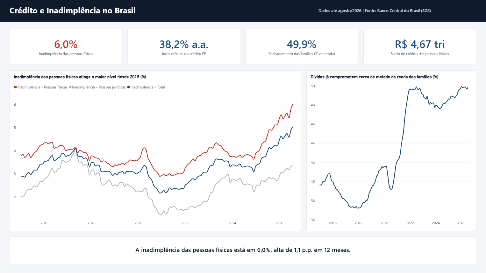
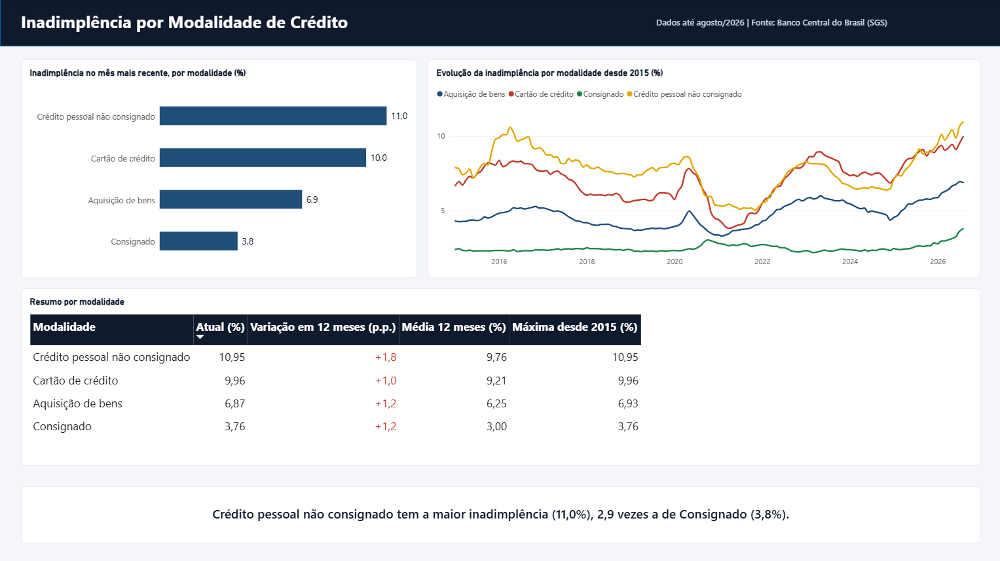
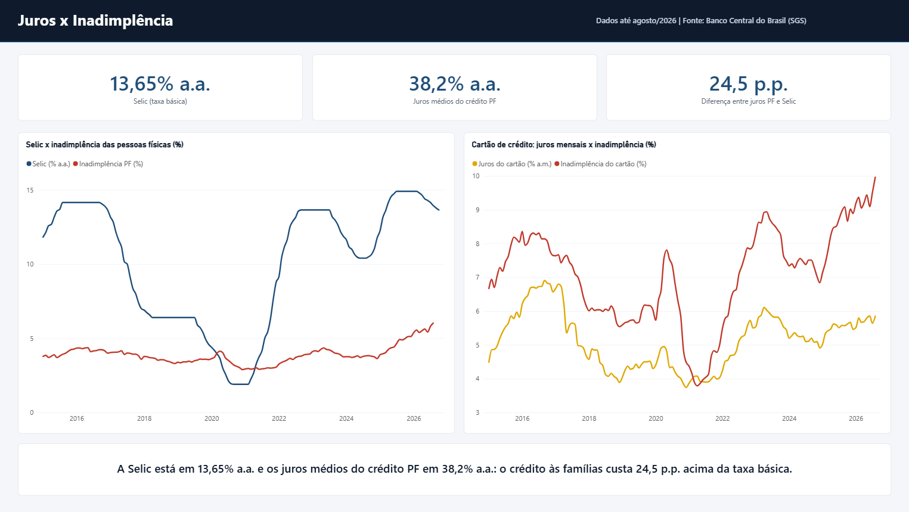

# Painel de Crédito e Inadimplência no Brasil

Dashboard em **Power BI** que acompanha a saúde do crédito das famílias brasileiras com **dados oficiais e atualizáveis do Banco Central**: inadimplência, juros, volume de crédito e endividamento.

## Por que este projeto
Trabalho com crediário no varejo e estudo o domínio financeiro no curso de Análise e Desenvolvimento de Sistemas da FIAP. Quis entender, com dados públicos, como juros e endividamento se relacionam com a inadimplência das pessoas físicas, que é o mesmo problema que bancos, fintechs e lojas com crediário enfrentam no dia a dia.

## Perguntas que o painel responde
1. Como a inadimplência de pessoas físicas evoluiu desde 2015?
2. Quais modalidades de crédito têm a maior inadimplência?
3. A alta da Selic e dos juros acompanha a alta da inadimplência?
4. Quanto da renda das famílias está comprometida com dívidas?

## Principais conclusões (dados até agosto/2026)
- **A inadimplência das pessoas físicas chegou a 6,0%**, alta de 1,1 ponto percentual em 12 meses e o maior nível de toda a série desde 2015.
- **Todas as modalidades analisadas pioraram em 12 meses**, e três delas estão no maior nível desde 2015: crédito pessoal não consignado (10,95%), cartão de crédito (9,96%) e consignado (3,76%).
- **O crédito pessoal não consignado tem inadimplência 2,9 vezes maior que a do consignado**, que tem desconto direto em folha.
- **As dívidas comprometem cerca de 50% da renda anual das famílias** (49,9% em julho/2026), contra cerca de 37% em 2018.
- **Os juros médios do crédito às pessoas físicas estão em 38,2% ao ano**, 24,5 pontos acima da Selic (13,65% ao ano).

## Como foi feito
| Etapa | Ferramenta | O que foi feito |
|---|---|---|
| Extração | Power Query (M) | Função personalizada que consulta a API do SGS do Banco Central para 13 séries |
| Tratamento | Power Query (M) | Conversão de datas e valores, empilhamento das séries em formato longo |
| Modelagem | Power BI | Tabela fato `fSeries` + tabela calendário `dCalendario` |
| Cálculos | DAX | Último valor, variação em 12 meses, média móvel, spread juros x Selic, textos dinâmicos |
| Visualização | Power BI | 3 páginas: Visão Geral, Por Modalidade e Juros x Inadimplência, com títulos e conclusões que se atualizam sozinhos |
| Resiliência | Power Query (M) | Repetição automática das chamadas, porque a API do Banco Central é instável e às vezes devolve erro 502 |

## Séries utilizadas (SGS - Banco Central)
| Código | Indicador |
|---|---|
| 21082 | Inadimplência da carteira de crédito - Total |
| 21084 | Inadimplência - Pessoas físicas - Total |
| 21083 | Inadimplência - Pessoas jurídicas - Total |
| 21112 | Inadimplência PF - Recursos livres - Total |
| 21129 | Inadimplência PF - Cartão de crédito total |
| 21114 | Inadimplência PF - Crédito pessoal não consignado |
| 21119 | Inadimplência PF - Crédito pessoal consignado total |
| 21123 | Inadimplência PF - Aquisição de bens total |
| 20541 | Saldo da carteira de crédito - Pessoas físicas - Total |
| 20716 | Taxa média de juros - Pessoas físicas - Total |
| 25479 | Taxa média mensal de juros - PF - Cartão de crédito total |
| 4189  | Selic acumulada no mês anualizada (base 252) |
| 29037 | Endividamento das famílias com o SFN em relação à renda (12 meses) |

Fonte: [Portal de Dados Abertos do Banco Central](https://dadosabertos.bcb.gov.br/)

## Arquivos
- `Painel_Credito_Inadimplencia.pbip` - projeto do Power BI (abra este arquivo)
- `Painel_Credito_Inadimplencia.Report/` - páginas e visuais em formato PBIR
- `Painel_Credito_Inadimplencia.SemanticModel/` - modelo, consultas e medidas em formato TMDL
- `1_PowerQuery_fSeries.pq` - código M da extração
- `2_Medidas_DAX.dax` - medidas e tabela calendário
- `imagens/` - prints das páginas

## Autor
**Arthur Hirotani** - Estudante de ADS na FIAP | Dados & BI
[LinkedIn](https://www.linkedin.com/in/arthurhirotani)
